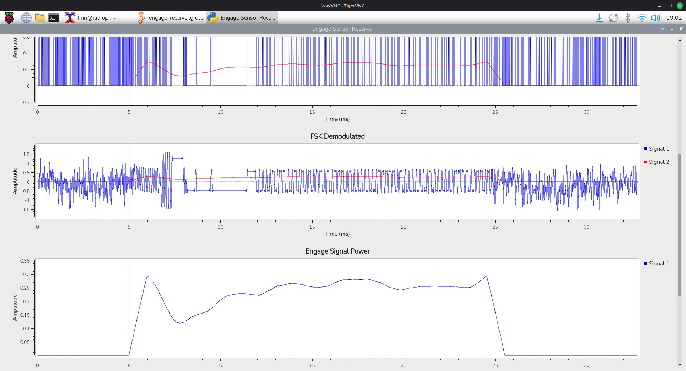

# Efergy Engage / e2CT SDR receiver

A live, headless **433 MHz FSK receiver and decoder** for the Efergy Engage / e2CT wireless electricity-monitoring transmitter. Built in **GNU Radio Companion (GRC)** and running on multiple Linux hosts using **RTL-SDR or bladeRF**, either natively or in Docker.

The receiver decodes Efergy packets, validates their checksums, measures RF signal quality, and publishes results over **MQTT** with **automatic Home Assistant discovery**. It supports multiple transmitter IDs without preconfiguring them.



## Features

- Live RTL-SDR or bladeRF reception; **no IQ recording or offline playback required**.
- FSK demodulation, pulse-width decoding, framing and 8-bit checksum validation.
- Adaptive, noise-relative packet detection with hysteresis and pre-trigger buffering.
- Device ID, current (A), battery status, learn flag and configurable transmitter interval (6, 12 or 18 seconds).
- Per-packet **RSSI, noise floor and SNR**, plus measured FSK tone frequencies and deviation.
- Per-transmitter estimated reception percentage and missed packets.
- Automatic discovery of multiple transmitters, with separate MQTT topics, Home Assistant entities and a **fixed 45-second RF availability timeout** per transmitter.
- Headless Docker or systemd operation with low idle CPU utilisation.

## Requirements

- Linux x86-64 or ARM64 host with Docker Engine and the Compose plugin.
- RTL-SDR or bladeRF USB receiver and a suitable 433 MHz antenna.
- Reachable MQTT broker; Home Assistant MQTT discovery is supported.

The receiver has run on multiple Linux systems, including Docker in an Ubuntu virtual machine. For VM deployments, pass the SDR through the hypervisor first, then to Docker.

## Quick start — Docker

On each Linux host, install Docker Engine and Compose, then clone the repository:

```bash
git clone https://github.com/F1nn/Efergy-Receiver.git
cd Efergy-Receiver
```

All configuration lives in **`compose.yaml`**. There is no `.env` file and no other Compose file.

The supplied settings work as a starting point for an RTL-SDR:
- Receiver identity: `efergy-receiver` (set `hostname` and `ENGAGE_RECEIVER_ID` to the same unique name on each installation).
- SDR: `ENGAGE_SDR_ARGS: "rtl=0"`. For bladeRF, replace it with `"bladerf=0"`.
- MQTT: `homeassistant.local`, user `mqtt`, password `mqtt` (test-instance defaults).
- Activity GPIO: disabled.

If the broker's mDNS `.local` name does not resolve, use its IP address instead. Do not run two receivers against the same physical SDR.

```bash
docker compose pull
docker compose up -d
docker compose logs -f efergy-receiver
```

The image is pulled from **GitHub Container Registry**, `ghcr.io/f1nn/efergy-receiver:latest`, not built on each installation. GitHub Actions builds/publishes amd64 and arm64 images when changes reach `main`. The first published image is only available after the workflow succeeds, and the GHCR package may need to be marked public for anonymous pulls.

To update:

```bash
git pull
docker compose pull
docker compose up -d
```

To stop: `docker compose down`.

**USB access:** Compose maps `/dev/bus/usb` and allows USB character devices. Check `rtl_test -t` or `bladeRF-cli -p` on the host if detection fails. A VM must also have hypervisor-level USB passthrough.

**Optional activity LED:** Uncomment the two `ENGAGE_STATUS_LED_*` environment entries and the `devices` mapping in `compose.yaml`, adjusting the GPIO line and `/dev/gpiochip0` as necessary. The LED pulses for about 120 ms on each checksum-valid packet. Without GPIO hardware, keep all of them commented.

### Build locally (development)

If you are changing the flowgraph, a local Docker build still works. It compiles `engage_receiver.grc` into Python with GNU Radio's `grcc`:

```bash
docker build -t ghcr.io/f1nn/efergy-receiver:latest .
docker compose up -d --pull never --force-recreate
```

Ordinary installations do not require local builds. The GRC file is the source of truth, not the generated `.py` file.

## Signal-processing flowgraph


All three decoder stream inputs run at **500 kS/s**. The third input is the *filtered float demodulation signal*, **before** Binary Slicer; it is used for FSK-frequency estimates. No Throttle block is used with the hardware SDR source.

The Efergy decoder and MQTT publisher are **Embedded Python Blocks** within the `.grc` project. In GRC, save changes and press **F5** to regenerate the runnable Python script; do not edit the generated script as the source of truth.

## Protocol notes

The observed transmission is FSK with pulse-width encoding. Nominal pulse widths are around **64 µs** (short), **136 µs** (long) and **500 µs** (synchronisation). A decoded packet contains **64 bits / 8 bytes**; the final byte is an additive checksum of the preceding seven bytes, modulo 256.

The decoder publishes only accepted packets after framing and checksum validation. Checksums are useful for rejecting noise and unrelated RF activity, but they are not cryptographic authentication.

The radio measurements are **relative to the receiver's digital full scale (dBFS)**, not calibrated dBm at the antenna input. FSK tone frequencies are estimates from the filtered demodulated waveform. Estimated missed packets and reception rate are inferred from gaps between accepted packets; the protocol has no sequence number. Those counters reset when the receiver restarts.

## MQTT topic structure

With the receiver ID set via `ENGAGE_RECEIVER_ID` (or the system hostname when unset) and topic prefix `engage`:

```text
efergy/events                                         # all valid packets, JSON
engage/receivers/<HOSTNAME>/availability              # receiver MQTT online/offline
engage/receivers/<HOSTNAME>/sensors/<ID>/state        # each sensor's packet JSON
engage/receivers/<HOSTNAME>/sensors/<ID>/rf_availability
homeassistant/<component>/engage_<HOSTNAME>_<ID>_<entity>/config
```

`<HOSTNAME>` identifies this receiver, and `<ID>` comes from the transmitted packet, so newly encountered transmitters are handled automatically. Discovery messages and availability statuses are retained; ordinary packet events are not. MQTT receiver connectivity and RF sensor reception have independent availability states. A sensor is marked RF-offline after **45 seconds without a valid packet** and restored on the next valid packet. On startup, the MQTT publisher subscribes to its own retained sensor availability records. Previously known sensors are marked RF-offline until a fresh valid packet is received, preventing stale online statuses after a receiver restart.

Example *illustrative* sensor payload (exact optional fields depend on decoder version):

```json
{
  "model": "Efergy-e2CT",
  "id": 55082,
  "current": 7.318,
  "battery_ok": true,
  "interval": 6,
  "learn": false,
  "mic": "CHECKSUM",
  "checksum_ok": true,
  "raw": "0b2ad740751803dc",
  "rssi": -4.57,
  "noise": -42.12,
  "snr": 37.55,
  "rf_power_unit": "dBFS",
  "freq1": 433.4924,
  "freq2": 433.5765,
  "fsk_deviation_khz": 42.1,
  "reception_rate": 100.0,
  "packets_missed_est": 0
}
```

Home Assistant MQTT discovery adds current, battery, last-received time, packet count and checksum status, plus RF diagnostics (RSSI, SNR, noise, frequencies, deviation, reception percentage and estimated missed packets). **No manual sensor definitions in `configuration.yaml` are needed** if MQTT discovery is enabled.

Note: two physically different transmitters using the *same transmitted sensor ID* cannot be uniquely separated on one receiver solely by protocol ID.

## Running without Docker

For native Linux deployments, install GNU Radio, gr-osmosdr, NumPy and Paho MQTT. Configure the SDR and MQTT environment variables shown in `compose.yaml` for your systemd service or shell. Generate the Python receiver with:

```bash
grcc -o . engage_receiver.grc
python3 -u engage_receiver.py
```

`ENGAGE_RECEIVER_ID` is optional outside Docker and defaults to the system hostname. The optional GPIO LED additionally requires Python libgpiod v2.

## Licence

This project is released under the [MIT License](LICENSE).
